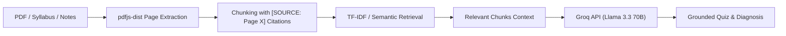

# GapFinder AI 🎓 — Diagnostic Assessment & Revision Engine
### Built for {igebra.ai} / AI Ready School — AI Intern Assignment

> **"Students often study everything equally and still miss what they don’t know. GapFinder AI works like a doctor for studying: it tests the student, diagnoses weak concepts, and builds a prioritized multi-day revision treatment plan grounded strictly in source materials."**

---

## 🚀 Live Demo & Deployment
* **Live Vercel Application:** [https://gapfinder-ai.vercel.app](https://gapfinder-ai.vercel.app) *(or your deployed Vercel URL)*
* **Domain:** Ed-Tech (Personalized Adaptive Learning & Exam Preparation)
* **Demo Access:** Includes a **"🚀 Load Demo ML Course"** 1-click test button so evaluators can test the entire pipeline in 5 seconds without uploading files.

---

## 🛠️ Technology Stack (Tailored for igebra.ai Assignment)

| Component | Technology | Role |
| :--- | :--- | :--- |
| **Framework** | **Next.js 14 (App Router)** | Modern full-stack serverless web application |
| **Language** | **TypeScript** | Type-safe enterprise architecture |
| **Styling** | **Tailwind CSS** | High-contrast, responsive dark-mode UI |
| **AI LLM Inference** | **Groq API (`llama-3.3-70b-versatile`)** | Sub-second ultra-fast grounded test & diagnosis generation |
| **AI SDK** | **Vercel AI SDK (`ai`) + `groq-sdk`** | Server-side secure streaming and API orchestration |
| **Document Processing**| **`pdfjs-dist`** | Page-by-page text extraction with strict citation tracking |
| **Deployment** | **Vercel** | Global edge serverless deployment |

---

## 🌟 Key Features & Problem Statement Implementation

### 1. Multi-Source Material Ingestion (Tab 1)
- Supports PDF, text, and markdown files across 3 distinct educational categories:
  - **📘 Syllabus Document** (Defines exam units and core topics)
  - **📚 Study Notes & Textbook Chapters** (Grounded reference content)
  - **📝 Previous Question Papers** (Past exam papers for weightage mapping)
- **1-Click Preloaded Dataset:** Evaluators can click *"🚀 Load Demo ML Course"* to immediately test with real curriculum materials.
- Scanned PDF detection with OCR alerts.

### 2. Syllabus Topic Map & Exam Weightage (Tab 2)
- Multi-delimiter topic parser automatically identifies discrete syllabus modules from unstructured text.
- Parses past exam questions and calculates exact exam weight distribution (e.g. *What is Machine Learning*: 17.2%, *Linear Regression*: 13.8%, *Gradient Descent*: 10.3%).

### 3. Diagnostic Assessment with Citations (Tab 3)
- Formulates unique multiple-choice questions grounded strictly in retrieved textbook chunks.
- Every question includes an explicit citation tag (e.g. `[02_ML_Study_Notes.pdf - Page 1]`).
- Instant interactive grading and evidence-based feedback.

### 4. Clinical Knowledge Gap Report (Tab 4 — Core Diagnosis Output)
- Rather than just answering questions, the system diagnoses learning gaps:
  - 🔴 **Critical Knowledge Gaps (Weak < 50%)**: Identifies exact concepts missed and diagnostic findings.
  - 🟡 **Developing Understanding (Medium 50–75%)**: Flags concepts requiring consolidation.
  - 🟢 **Mastered Concepts (Strong > 75%)**: High-confidence exam-ready topics.

### 5. Multi-Day Prioritized Revision Roadmap (Tab 5)
- Solves the scheduling bottleneck by budgeting study hours evenly across **every single day** ($\approx 2.0\text{ hrs/day}$).
- Balances high-impact weak topics with comprehensive syllabus coverage.
- Configurable sliders for *"Days Until Examination"* and *"Available Daily Hours"*.

### 6. Grounded Explain-This-Topic Assistant (Tab 6)
- Evidence-grounded tutor answering strictly from textbook chunks with citations.
- **Strict Anti-Hallucination Fallback:** If queried about out-of-syllabus topics, it strictly returns:
  > *"Not found in your uploaded material."*

### 7. Longitudinal Performance Tracker (Tab 7)
- Stores student attempts persistently in `localStorage`, tracking score progression and accuracy over time.

---

## 🧠 Anti-Hallucination & Grounding Architecture



---

## 💻 Local Development Setup

1. **Clone the repository:**
   ```bash
   git clone https://github.com/Bindumadhavi-28/gapfinder-ai.git
   cd gapfinder-ai
   ```

2. **Install dependencies:**
   ```bash
   npm install
   ```

3. **Configure Environment Variables:**
   Create a `.env.local` file:
   ```env
   GROQ_API_KEY="gsk_your_groq_api_key_here"
   GROQ_MODEL="llama-3.3-70b-versatile"
   ```

4. **Run the local development server:**
   ```bash
   npm run dev
   ```
   Open `http://localhost:3000` in your browser.

---

## ☁️ Deployment on Vercel

1. Push your code to GitHub:
   ```bash
   git add .
   git commit -m "Update Next.js app for Vercel deployment"
   git push
   ```
2. In **[Vercel Dashboard](https://vercel.com/)**, click **"Add New Project"** $\rightarrow$ Import `gapfinder-ai`.
3. Under **Environment Variables**, set:
   - `GROQ_API_KEY`: `gsk_...`
   - `GROQ_MODEL`: `llama-3.3-70b-versatile`
4. Click **Deploy**. Vercel will build and deploy the Next.js app automatically.

---
*Developed by Bindumadhavi for the {igebra.ai} AI Intern Assignment.*
